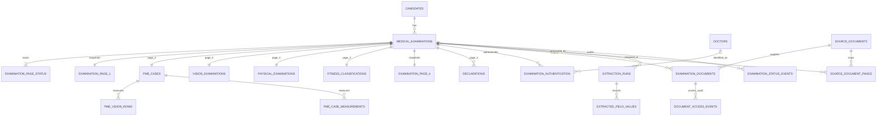

# Four-page examination schema

## Ownership

`candidates` is the stable identity master. `medical_examinations` represents
one historical form and remains linked to exactly one candidate. Candidate
identity values observed on Page 1 and repeated Page 4 particulars are saved in
`examination_page_1` and `examination_page_4`; subsequent imports do not rewrite
the candidate master. Page 1 `Class` is `examination_page_1.candidate_class`.
It is not a Page 3 medical evaluation class. `dv_date` and
`medical_examination_date` remain separate. The supplied form has no due-date
or Aadhaar field, so neither is stored.

Page 2 uses the existing `pme_cases`, `pme_vision_rows`, and
`pme_case_measurements` tables, extended with raw/normalized measurement
columns and source-page references. Printed row labels and R/L values remain
literal; uncertain abbreviations are not expanded. Page 3 uses existing
`vision_examinations`, `physical_examinations`, and `fitness_classifications`.
Page 4 uses `examination_page_4` and `declarations`.

Each examination receives four `examination_page_status` rows. The migration
marks legacy pages `PENDING_REVIEW`, not verified. New imports set covered
pages to `PENDING_REVIEW` and uncovered pages to `NOT_STARTED`. Examination
state changes are recorded in `examination_status_events`; page verification
does not imply examination completion. `COMPLETED` requires all four pages to
be `VERIFIED`.

## Source and evidence

`source_documents` stores metadata for a SHA-256-addressed encrypted original.
`source_document_pages` explicitly classifies each original PDF page as a
candidate form page, supplemental page, or unclassified. Candidate pages keep
`packet_index`, `form_page_number` (1–4), and, after import,
`examination_id`. `examination_documents` stores encrypted per-examination
page images and cropped visual evidence with MIME type, byte size, checksum,
verification state, local form page, and original PDF page. The existing
`report_images` table remains the rendered-page reference and gains the
original PDF page number.

The opt-in `configs/splits.RRB-CANDIDATES-1.yaml` is checksum-pinned and has
twelve explicit candidate ranges and three supplemental ranges. It must not be
substituted for the default split map globally. Assembly can use it with
`--split-config`; source registration verifies the hash and refuses unconfirmed
or conflicting mappings.

Authentication records are per examination and page. The source form has
candidate photo/signature/LTI, an issuing-official mark on Page 1, and medical
examiner signatures/stamps on multiple later pages. Detection does not prove
identity or authenticity: every detected image starts `UNVERIFIED`, missing
images remain `MISSING`, and observed names/designations remain independent of
the doctor master.

## Field provenance

`extracted_field_values` records field name, raw and normalized JSON values,
local form page, source PDF page, confidence, validation and human-review
states, optional normalized bounding box, and the extraction run. Ambiguous
handwriting is stored as the raw observation with `AMBIGUOUS` validation and
`PENDING` review; no zero or guessed normalized value is inserted. Extraction
confidence is nullable because the current VLM extraction path does not emit a
score.

The current extraction JSON may contain Page 4 phone/email values. The importer
encrypts these into binary fields in `examination_page_4` and redacts these
values from persisted extraction JSON/provenance. Do not copy contact fields
into `candidates`, application logs, or ordinary report views.

## Migration and rollback

Revision `20261104_01` adds tables and columns and backfills Page 1/Page 4
snapshots, four review statuses, authentication placeholders, and lifecycle
events for legacy examinations. It does not backfill original documents or
invent source-page assignments. The existing doctor-column initializer no
longer drops contact columns. Existing drift in candidate-doctor foreign-key
and doctor nullability definitions is intentionally not normalized by this
revision.

Before a migration, create a timestamped backup and private schema/count
baseline. Test `alembic upgrade head` on a copy first. This migration is
forward-only; restore the pre-migration backup to roll back. Never run the
migration against production before explicit approval. The repository has no
authentication provider yet; deployments must provide one and pass a strict
authorization callback to document retrieval.